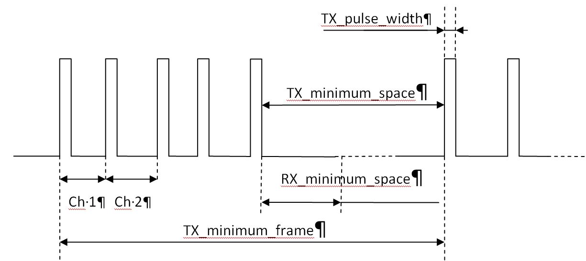

# RP2040_ppm
ppm encoder for  Raspberry Pi RP2040. Based on PIO peripheral of RP2040.

## RP2040_ppm
**_RP2040_ppm_** is a library that provides **coding of PPM signals** widely used in RC transmitters and receivers equipments.   
The library uses the **Programmable I/O (PIO) hardware subsystem** of the RP2040 and output waveforms are managed by the hardware, requesting only a small load to the CPU.  
Specifically designed for the RP2040 it has been tested on RP2040-Zero. (RP2040 Arduino Earle F. Philhower core 6.3.1)   
Up to 4 PPM streams can be managed on the same processor.  
 
 The library can handle PPM frames with up to 16 channels but usual RC PPM signals use less channels. A high number of channels may require some specific timing tuning. ([see Fine tunning chapiter](#tuning))  

 ## Remarks on used resources ##
Resources allocation is made dynamically at runtime and RP2040_ppm checks for PIO’s resources already used by others libraries.  
For each ppm stream the library uses a state machine SM and a PIO interrupt line. (A PIO has 2 interrupt lines. The RP2040 has 2 PIOs and so the library can handle at most 4 concurrent ppm streams.)  
Only unused PIO/SM/Interrupt are selected at runtime and used.    
RP2040_ppm should be able to cohabit with other modules using PIO resources.  

## Usage: 
### Include  
`#include <RP2040_ppm.h>`    
### Transmitting PPM Encoded Signals 
**ppmWriter(optional_polarity)**   
Create an oject for the generation of a PPM stream.   
Polarity must be RISING or FALLING . (**default RISING**)  

`ppmWriter monPPM_TX; // create a PPM stream, with positive rising edge start impulsion`   

**begin(tx_Pin, nbr_TX_Channels )**  
Initialize the PPM stream generated on GPIO tx_pin, with nbr_TX_Channels channels. (**default 8**).
The generation of the pulses must be started effectively with **start()**.   
The method returns a pointer to an array of integers where the user updates the values of each channel in microseconds (us).  
Returns NULL if an error occurs.
```
int* ppmArrayTX;
ppmArray = monPPM_TX.begin(19);  // 8 channels ppm stream on pin 19
…
ppmArray[1] = 1200;	//	value for channel 1
ppmArray[2] = 1300;	//	value for channel 2
…
```
Channel numbering is from 1 to n and index 0 of the array is used internally.  
*No checks* are done upon the values of the ppm channels. (usual values are between 1000 and 2000 us …), nor the channel number.  
**start()**   
start the PPM generation.    
**stop()**  
  stop the PPM generation. It can be resumed with **start()**   
**end()**  
  stop the PPM generation and free resources. The PPM stream must be reinitialized with a **begin(….)** before use.  

<a name="tuning"> 
 
## Fine tunning  

Usual RC PPM signal timing is with a start pulse (300us) and an overall frame length arround 20ms (frequency 50hz). Channel values are between 1000us and 2000us.  
By default the library uses this “standard” and it should satisfy most users.   
Nevertheless fine tuning is available and the user can change some specific values through public variables of the class. No checks are done in the library and bad values can give unpredictable results and even crashes.  

  

All values are in microseconds (us).  
## For encoder: 
**TX_pulse_width**   
length of the positive or negative pulse used for channel end/start (**default 300us**).  
**TX_minimum_space**  
minimum space between 2 frames. (**default 4000**).  
**TX_minimum_frame**  
minimum frame length. Define the frequency of the frame (**default 22500us**).
This value may be increased on a frame by frame basis if the encoding of the channels values plus the **TX_minimum_space** does not fit in the alloted **TX_minimum_frame**.  
This ensure that the decoder will always have enough time to detect the end of a frame. 


No checks are done in the library and bad values can give unpredictable results and even crashes.  
   
These values **MUST** be changed before the initilization of the stream object (so before begin (…) )  
```
  ppmWriter myPPM_TX;
...
  myPPM_TX.TX_pulse_width = 200;
  myPPM_TX.TX_minimum_space = 4500;
  myPPM_TX.TX_minimum_frame = 15000;
...
```

